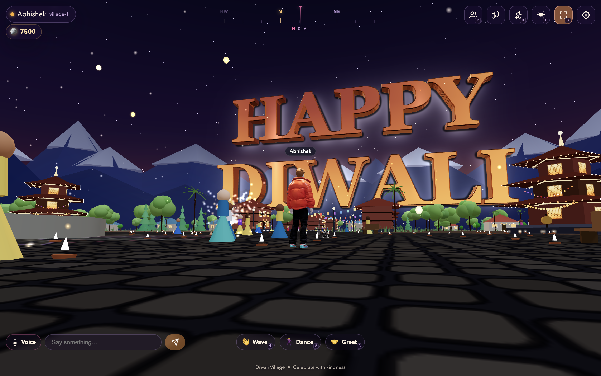

<div align="center">

# Celebrate Diwali

### Diwali Meet Up — a multiplayer festival of lights

Explore a festive 3D village, meet friends, light fireworks, and celebrate together in your browser.

[](https://nodejs.org/)
[](https://threejs.org/)
[](#voice-chat)

**[Play the live game](https://celebrate-diwali.onrender.com/)** · **[Getting started](#getting-started)** · **[Deployment](#deployment)** · **[Report an issue](https://github.com/1abhishek0948/Celebrate-Diwali/issues)**

</div>

[](https://celebrate-diwali.onrender.com/)

## Overview

**Diwali Meet Up** is a real-time, browser-based social game built with Three.js, vanilla JavaScript, and an authoritative Node.js server. There is no combat: the experience focuses on exploration, conversation, shared celebrations, and a welcoming festival atmosphere.

The world is generated procedurally, with animated Ready Player Me characters and a procedural character fallback. The multiplayer game runs directly from ES modules; it does not require a frontend bundler or a game-client build step.

> **Live demo:** https://celebrate-diwali.onrender.com/
>
> The demo uses a free Render service. Its first request may take longer after a period of inactivity. On phones and tablets, rotate your device to **landscape** and keep graphics on **Auto** or **Cool**.

## Features

| Area | Highlights |
| --- | --- |
| Festival world | An illuminated plaza, temples, lanterns, bonfire, fireworks, landscaped streets, and day/night modes. |
| Multiplayer | Server-validated movement, interpolated remote players, room-based chat, and reconnect support. |
| Characters | Customizable appearance, animated walking/running/jumping, and Wave, Dance, and Greet emotes. |
| Social | Player lists, friends and presence, private messages, invitations, and blocking/reporting controls. |
| Houses | 24 residential plots, furnished interiors, seating, ownership, and public/friends/private access modes. |
| Fireworks & economy | Two interactive stores, a server-managed wallet, inventory, item bundles, and shared item effects. |
| Voice | Opt-in microphone with room-wide, peer-to-peer WebRTC audio. |
| Mobile | Multi-touch joystick, camera drag, Jump/Use controls, landscape guidance, and conservative graphics defaults. |

### Fireworks and virtual currency

New profiles start with **7,500 Diwali Coins**, a free in-game currency with no real-money checkout. The server validates prices, quantities, inventory limits, and item consumption.

- **Diya:** place a glowing clay lamp.
- **Anar:** light a ground spark fountain.
- **Chakri:** launch a spinning ground firework.
- **Phuljhadi:** carry a handheld sparkler.
- **Rocket:** send a sparkling rocket into the sky.
- **Aerial Shots:** create a colorful aerial burst.
- **Bundles:** purchase packs that add their individual items to your inventory.

Open a shop, purchase an item, equip it from your inventory, and press **F** or tap **Use** to activate it.

## Getting started

### Requirements

- **Node.js 18 or newer**; a currently supported LTS release is recommended.
- **npm**, included with Node.js.
- A modern browser with **WebGL** enabled, such as Chrome, Edge, Firefox, or Safari.
- An internet connection for the live multiplayer demo.
- **HTTPS or localhost** for microphone access.

### Run the multiplayer game locally

```bash
git clone https://github.com/1abhishek0948/Celebrate-Diwali.git
cd Celebrate-Diwali
npm ci
npm run start:game
```

Open **http://localhost:3000/**, choose a display name, customize your character, and select **Celebrate with World**.

`npm start` is an alias for the same game server. At startup, the server prepares the browser-side Three.js modules from the installed dependency.

To use another port on macOS or Linux:

```bash
PORT=4000 npm run start:game
```

### Test with another player

Open the game in **two different browsers**, or use a normal window and a private/incognito window. Each independent browser storage context receives its own device identity.

Two ordinary tabs in the same browser share a device token. Signing in with that token from another tab takes over the existing session; it does not create a second player.

## Controls

### Desktop

| Input | Action |
| --- | --- |
| **W / A / S / D** or **arrow keys** | Walk relative to the camera. |
| **Shift** + movement | Run. |
| **Space** | Jump. |
| **Hold mouse button + drag** | Rotate the camera. |
| **Mouse wheel** | Zoom in or out. |
| **E** | Use the nearby interaction shown on screen. |
| **F** | Activate the equipped item. |
| **I** | Open the firecracker inventory. |
| **1 / 2 / 3** | Wave / Dance / Greet. |
| **P** | Toggle the player list. |
| **B** | Toggle the friends panel. |
| **V** | Toggle the microphone. |
| **T** | Switch between day and night. |
| **G** | Toggle fullscreen where supported. |
| **Esc** | Close supported overlays and panels. |

### Phones and tablets

- Play in **landscape** orientation; rotate manually if the browser cannot lock orientation.
- Move with the **bottom-left joystick**. Push it farther to run.
- Drag the **right-side camera area** to look around.
- Tap **Jump** or **Use** on the right. Use appears when an equipped item or nearby interaction is available.
- Use the HUD buttons for inventory, friends, players, settings, day/night, and fullscreen.
- Tap **Voice** to enable or disable your microphone, and use the emote buttons to greet others.
- Multi-touch supports movement and jumping/camera control together.

## Graphics and mobile performance

Choose a quality profile in **Settings → Graphics quality**.

| Profile | Maximum rendering pixel ratio | Frame-rate cap | Shadows |
| --- | --- | --- | --- |
| **Auto** | Selects a device profile. | Depends on selected profile. | Depends on selected profile. |
| **Cool** | 0.75 | 30 FPS | Off |
| **Low** | 1.0 | 30 FPS | Off |
| **Medium** | 1.5 | 60 FPS | On |
| **High** | 2.0 | 60 FPS | On |

**Auto selects Cool on phones and tablets.** Desktop Auto normally selects High, or Medium when the browser reports 4 GB or less of device memory. Rendering resolution is also limited by the display's pixel ratio; actual frame rates depend on the device and scene.

Cool reduces continuous GPU and CPU work through:

- Lower rendering resolution, no shadows, and fewer decorative lights.
- Smaller ambient effect pools and nearby-only ambient cracker activity.
- Spatial culling of distant trees and grass without changing collisions or plaza dimensions.
- Drawing only living fireworks, smoke, and spark particles.
- Sleeping the hidden world behind startup menus and reducing work while in-game panels are open.
- Lower-frequency name-label updates and voice-membership sorting; audio itself is not throttled.
- Pausing the render loop when the page is hidden and resuming after supported graphics-context recovery.

> These optimizations reduce workload, not guarantee a particular battery life or device temperature. Medium and High can increase power consumption. If your device becomes uncomfortably hot, stop the session and let it cool down.

## Voice chat

Voice uses a **room-scoped WebRTC mesh**, with audio at equal volume rather than distance-based attenuation. Listening starts when you enter the world; the microphone stays off until you enable it.

- Allow microphone access when prompted, then use **V** or the **Voice** button to toggle your mic.
- Each player can connect to up to **16 voice peers**. If a room exceeds that limit, nearer peers are prioritized.
- Voice requires **HTTPS** or **localhost**. Plain-HTTP LAN addresses can serve the game, but browsers block microphone access there.
- The current implementation uses **STUN, not TURN**. Some restrictive networks or NAT configurations may prevent peer-to-peer audio even when text chat works.

## Architecture

```text
Browser clients
  ├── Three.js rendering, local input, collisions, and interpolation
  ├── WebSocket messages ────────────────┐
  └── WebRTC audio between peers        │
                                        ▼
                              Node.js + ws server
                                ├── Rooms and player state
                                ├── Movement and rate validation
                                ├── Chat, friends, houses, and voice signaling
                                ├── Wallet and inventory validation
                                └── File-backed profile persistence
```

The server broadcasts snapshots at **20 Hz**; clients send movement updates at approximately **15 Hz** and interpolate remote motion. Nearby movement snapshots use an **80-unit interest radius**. Village rooms are capped at **100 players** and house interiors at **12 occupants**; these are configured limits, not guarantees of browser or hosting performance.

HTTP assets and WebSocket connections share the same origin and port. Shared constants keep the client and server aligned on world layout, item catalogs, and protocol values.

### Repository structure

```text
Celebrate-Diwali/
├── client/              Multiplayer game UI, rendering, and bundled assets
│   ├── assets/          Avatar models and animation clips
│   ├── css/             Game styles and responsive controls
│   ├── js/              World, festival, networking, input, voice, and screens
│   └── vendor/          Three.js modules prepared at server startup
├── server/              HTTP/WebSocket server, rooms, persistence, and economy
├── shared/              Protocol, world layout, and item constants
├── public/              Separate static website for Vercel
├── tests/               Automated client, economy, and server regressions
├── tools/               Static verification, browser diagnostics, and load tools
├── docs/                Setup, architecture, roadmap, and asset-license notes
├── loads/               Historical load-test report
├── data/                Runtime-created profile storage
├── demo.png             Gameplay screenshot used in this README
├── render.yaml          Multiplayer game deployment configuration
└── vercel.json          Separate static website deployment configuration
```

## Development and validation

```bash
npm test
npm run build
```

- **`npm test`** runs the Node.js regression suite: currently **51 tests** covering client scheduling and controls, graphics profiles, economy validation, and multiplayer behavior.
- **`npm run build`** verifies the separate static website in `public/`. It does **not** bundle or compile the multiplayer game.
- **`npm run start:site`** previews only the static website, on port 3000 by default. Use a different `PORT` if the game server is already running.

Additional browser and load diagnostic scripts are available in `tools/`. The existing browser scripts assume a macOS Chrome installation and fixed local ports; review those assumptions before running them on another system. The [historical load report](loads/load-report.md) documents an earlier 100-bot loopback run, not a current production benchmark.

### Server configuration

| Variable | Default | Purpose |
| --- | --- | --- |
| `PORT` | `3000` | HTTP and WebSocket listening port. |
| `DATA_DIR` | `./data` | Directory containing the server's `profiles.json` store. |
| `ALLOWED_ORIGINS` | None | Comma-separated additional WebSocket origins for alternate hosts or LAN testing. The serving origin and localhost are accepted automatically. |
| `DiwaliMeetUp_ALLOW_TELEPORT` | Off | Development/test-only movement bypass when set to `1`. **Do not enable for public deployments.** |
| `DiwaliMeetUp_DEBUG_MSG` | Off | Logs incoming message types when enabled. |

## Deployment

### Multiplayer game — Render

**Live service:** [celebrate-diwali.onrender.com](https://celebrate-diwali.onrender.com/)

The game needs a continuously running Node.js service with WebSocket support. The included [`render.yaml`](render.yaml) defines:

| Setting | Value |
| --- | --- |
| Service name | `diwali-meetup-game` |
| Runtime | Node.js |
| Install/build command | `npm ci` |
| Start command | `npm run start:game` |
| Health-check path | `/health` |
| Deployment trigger | Commits to the configured deployment branch |

To create your own deployment:

1. Fork or push this repository to your GitHub account.
2. In Render, select **New → Blueprint** and connect the repository.
3. Review the service defined in `render.yaml` and create it.
4. Wait for the deployment to complete, then open the service's HTTPS URL.
5. Confirm that `/health` returns `ok` and that the game loads. The browser automatically uses secure WebSockets on the same host.

For an existing service, pushes to its connected deployment branch trigger redeployment when auto-deploy is enabled. If needed, select **Manual Deploy → Deploy latest commit** in the Render dashboard.

> **Persistence warning:** the free service's filesystem is ephemeral. Profile data, friends, house ownership, wallet balances, and inventory may be lost when an instance is replaced, restarted, or redeployed. Use durable storage or a managed database before relying on the demo for persistent player progress.

### Separate static website — Vercel

[`vercel.json`](vercel.json) deploys **`public/` only**, not the multiplayer game. Import the repository with its root directory unchanged, or deploy with:

```bash
npm run build
npx vercel --prod
```

The current Vercel configuration does not host the game's persistent WebSocket server. Keep the multiplayer game on Render or another suitable Node.js host.

### Self-hosting

Run `npm ci` and `npm run start:game` behind an HTTPS reverse proxy that forwards WebSocket upgrades. Set `PORT` as needed and keep `DATA_DIR` on durable storage with backups. Additional browser origins can be allowed through `ALLOWED_ORIGINS`.

## Limitations and production considerations

This is a playable prototype, not a hardened account-based platform.

- **Device-based identity:** browser tokens identify sessions; there is no secure user-account authentication or recovery flow.
- **Single-process server:** there is no distributed room coordination or horizontal scaling layer.
- **File-backed storage:** production deployments need a deliberate durability, backup, and migration strategy.
- **Voice connectivity:** STUN-only peer connections do not work reliably on every network; TURN support is a future improvement.
- **Commercial buildings:** firework shops provide purchase interfaces, but shop facades do not have enterable interiors.
- **Capacity:** server room caps, historical load results, and graphics caps do not establish performance on every phone or hosting plan.

Before operating a persistent public community, add secure authentication, durable storage, reliable voice relay infrastructure, and stronger operational/moderation tooling.

## Documentation

- [Setup notes](docs/SETUP.md)
- [Architecture and protocol notes](docs/ARCHITECTURE.md)
- [Roadmap](docs/ROADMAP.md)
- [Third-party components and asset licenses](docs/LICENSES.md)
- [Historical load-test report](loads/load-report.md)

Some supplementary documents describe earlier prototype versions. For current limits, world layout, and item definitions, use [`shared/constants.js`](shared/constants.js) and the implementation as the source of truth.

## Contributing

Bug reports and focused improvements are welcome. Include your browser/device, reproduction steps, expected behavior, and relevant screenshots or console errors in an [issue](https://github.com/1abhishek0948/Celebrate-Diwali/issues).

For code changes, keep client/server behavior consistent, add regression coverage where appropriate, and run `npm test` before submitting a pull request. Do not commit personal profile data, credentials, or generated dependency folders.

## Credits and licensing

Created by **[Abhishek Thakur](https://github.com/1abhishek0948)**.

- **Three.js** and **ws** are MIT-licensed dependencies.
- Character models and animation clips use **Ready Player Me** assets with their own usage and redistribution terms.
- See [`docs/LICENSES.md`](docs/LICENSES.md) for attribution and asset restrictions. Do not assume every bundled asset is covered by the dependencies' MIT licenses.
- A standalone license for the project's original source is not currently declared in this repository.

---

<div align="center">

**[Enter the village](https://celebrate-diwali.onrender.com/)** · Celebrate with kindness.

</div>
